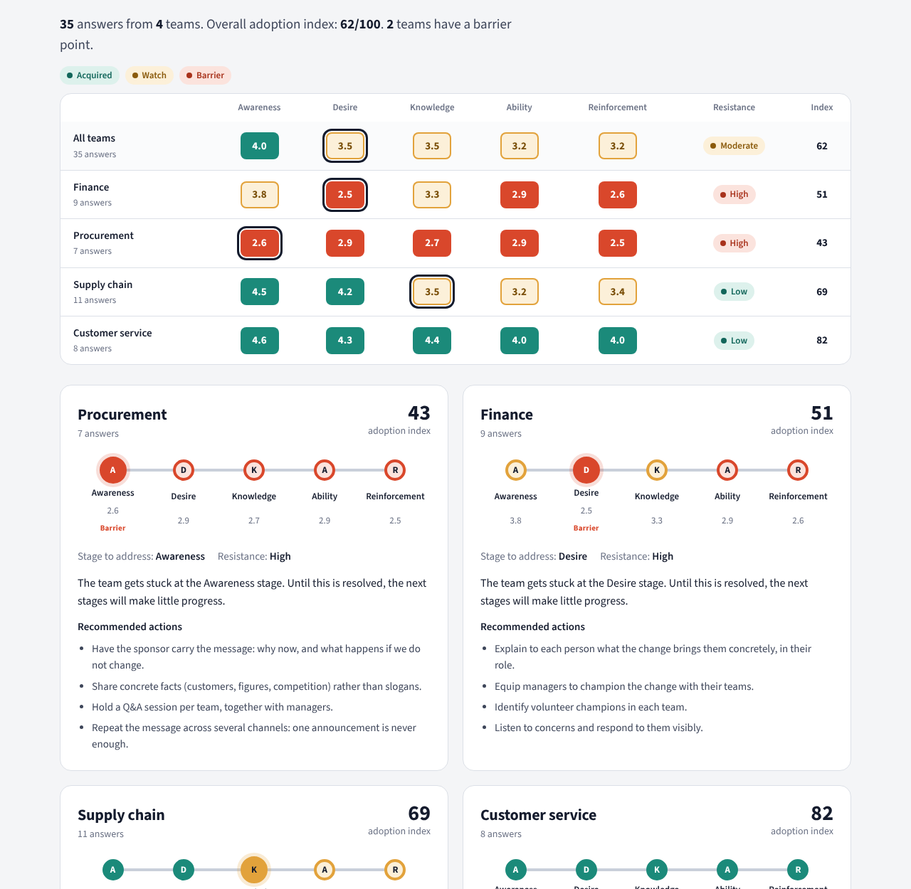

# Change Barometer

**A free survey that shows where each team gets stuck during a transformation, and what to do about it.**

Available in English, French and Japanese. No account, no server, no data collected.

**Live tool:** https://constanceweber6-alt.github.io/change-barometer/
**Example dashboard:** https://constanceweber6-alt.github.io/change-barometer/dashboard.html#demo

## Why this tool

In most transformation projects (new ERP, reorganisation, new ways of working), the same question comes back in steering committees: *which teams are on board, and which ones are stuck?* The answer usually comes from impressions in meetings.

This barometer gives a quick, structured answer, based on the ADKAR model of individual change: Awareness, Desire, Knowledge, Ability, Reinforcement. The stages are sequential, so the most useful information is **the first stage where a team gets stuck**. That is where support efforts should go first.

## How it works

1. **Create a barometer.** Enter the project name and the list of teams, with their headcount if you know it (`Finance ; 12`). You get a survey link, a dashboard link, a QR code and a ready to send email.
2. **Send the survey.** By email, or with a printable A4 poster carrying the QR code for frontline teams without email (warehouses, hotels, stores). Each person picks their team and rates 15 statements (3 per stage) from 1 to 5. It takes about 3 minutes. At the end, they get an anonymous response code to send back.
3. **Read the dashboard.** Paste the codes you received (or a whole email, codes are picked out automatically). You can also import a Microsoft Forms or Google Forms export as CSV.

For each team, the dashboard shows:

* a score per ADKAR stage, in a heatmap across all teams
* the **barrier point**: the first stage below 3 out of 5 (or the first fragile stage between 3 and 4)
* the **level of resistance**, based on desire and awareness
* an **adoption index** out of 100
* **recommended actions** for the stage to address

It also includes:

* **Response tracking**: "7 answers out of 12" for each team, so you know where to send a reminder.
* **Action plan**: tick the recommended actions to keep, add your own, set an owner and a due date, then export the plan as CSV or print it.
* **Presentation mode**: a full screen view for a steering committee, with an overview, one screen per team and the action plan. Arrow keys to move, Esc to exit.
* **Detail by statement**: the 15 statements for each team, with the weakest points highlighted.

Results can be exported as CSV, or as a two page PDF report: a synthesis first (overall index, ADKAR profile, one line per team), then the priorities and the action plan by team.

## Anonymity and data

* Nothing is sent to a server. The survey, the codes and the analysis all run in the browser.
* A response code only holds the barometer reference, the team and the 15 ratings. No name, no email.
* A team's results only appear once it has at least 3 answers.
* Duplicated codes are ignored, and codes from another barometer are flagged.
* Headcounts and the action plan stay in the consultant's browser. To move to another computer, download a backup file from the dashboard and restore it there. Nothing is hosted.

## Scoring rules

| Score of a stage | Status |
| --- | --- |
| below 3 | Barrier |
| from 3 to below 4 | Watch |
| 4 or more | Acquired |

* Resistance = (Awareness + 2 × Desire) / 3. High below 3, moderate below 3.8, low otherwise.
* Adoption index = (average of the 5 stages minus 1) / 4 × 100.

## Using it with Microsoft Forms or Google Forms

If you prefer to collect answers in your usual survey tool, download the CSV template from the dashboard. It needs a `TEAM` column (or `EQUIPE`, `ÉQUIPE`, `チーム`) and one column per question, from `A1` to `R3`, with values from 1 to 5. Semicolons and commas are both accepted.

## Files

| File | Role |
| --- | --- |
| `index.html` | Home page and barometer creation |
| `survey.html` | The survey for team members |
| `dashboard.html` | Results, response tracking, team profiles, action plan, presentation |
| `poster.html` | Printable A4 poster with the survey QR code |
| `assets/core.js` | Questions, translations, scoring and code format |
| `assets/page.js` | Shared navigation and language switch |
| `assets/dashboard.js` | Dashboard logic |
| `assets/qr.js` | QR code generator written for this project, no external library |
| `tests/core.test.js` | Checks on the scoring and the response codes (`node --test tests/core.test.js`) |

## About

Built by [Constance Weber](https://www.linkedin.com/in/constance-weber), consultant in operational transformation and change management. Companion project to the [CSR pre-diagnostic](https://github.com/constanceweber6-alt/rse-prediagnostic).

ADKAR® is a registered trademark of Prosci, Inc. This independent tool is inspired by the model and is neither affiliated with nor endorsed by Prosci. The survey questions and recommended actions were written for this tool.

License: MIT.
